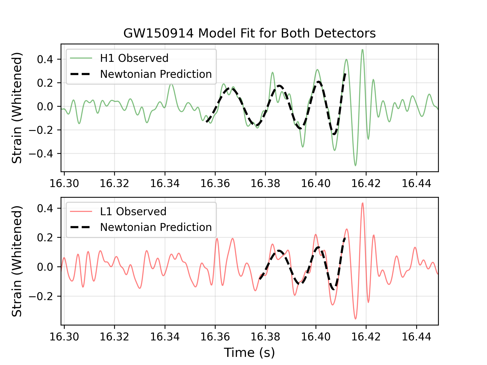

### Kshitij (Neil) Pandit
**MSci Physics with Theoretical Physics** | Imperial College London *(First-Class Standing)*

Focused on computational physics, signal processing in high-background environments, statistical inference, and low-level hardware/RF systems.

---

#### Featured Work

* **[LIGO Gravitational-Wave Discovery Pipeline](https://github.com/neilpanda/GW150914-Newtonian-Chirp)** — Modular Python pipeline (`NumPy`, `SciPy`, `h5py`) to whiten raw Hanford/Livingston strain data, model seismic and quantum noise budgets, and extract GW150914 at an **SNR of 86.26** while quantifying parameter estimation trade-offs (21% chirp mass overestimate) under Newtonian approximations.

* **[Custom Route Planner](https://github.com/neilpanda/route-planner)** - [UNFINISHED] Compares different modes of transport (via APIs) to recommend routes dependent on daily conditions. It also optimises hybrid routes for multiple modes of transport to save costs or time.

---

#### Technical Stack

* **Languages:** Python, C, C++, MATLAB, LaTeX
* **Data & Scientific Libraries:** NumPy, SciPy, Pandas, Matplotlib, h5py
* **Hardware & Engineering:** Embedded Microcontrollers, 868MHz RF Mesh Networking, mmWave Radar Sensors, Fusion 360 CAD
* **Workflow:** Git, Linux, Modular Package Design

---

#### Connect
[LinkedIn](https://www.linkedin.com/in/kshitij-pandit-94a27a300/) • [Imperial Email](kshitij.pandit24@imperial.ac.uk) • [Personal Email](kshitijneilpandit@gmail.com)
